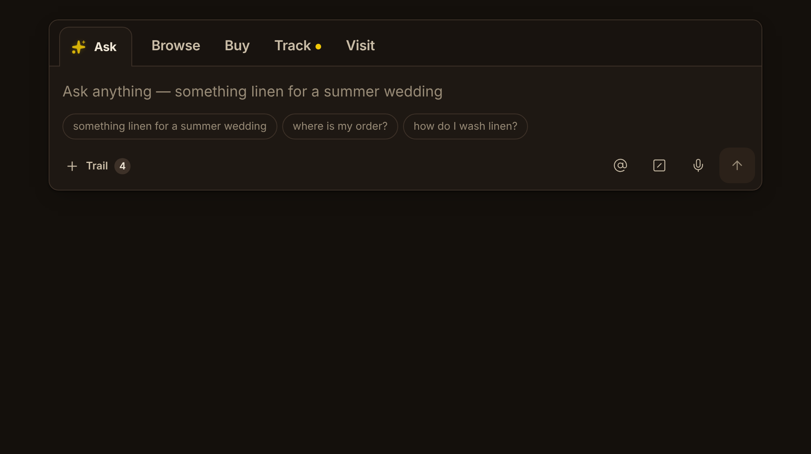
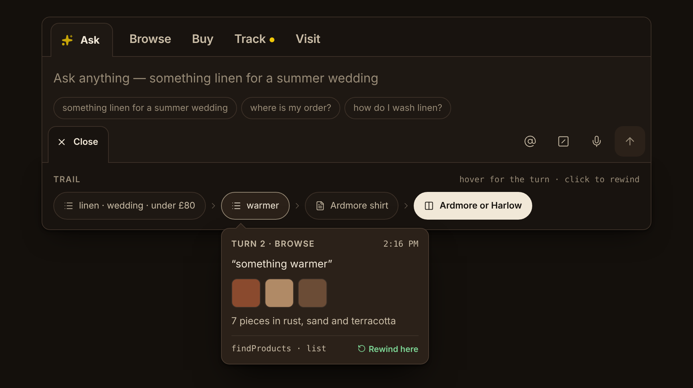

# Fishtea menu v1

The top-level navigation for Fishtea apps. It combines a prompt bar, a row of room links and a conversation trail into a single component. Ask is the free-typing tab, rooms replace the traditional menu, and the trail drawer slides out from under the bar. In the drawer, each turn is a pill with a summary card on hover; clicking a pill rewinds.




## Where it lives in FishTea

The handoff's reference code is now part of the framework, so it isn't repeated here:

| | |
|---|---|
| `packages/ui/src/menu/FishteaMenu.tsx`, `types.ts` | the component |
| `packages/ui/src/menu/fishtea-menu.css` | its styles (in the `components` layer) |
| `packages/ui/src/menu/tokens.css` | Ebony and Oak (in the `base` layer, so a brand's `--ft-*` wins) |
| `packages/ui/e2e/menu.e2e.ts` | SPEC §9, items 1–8, against `menu-harness.html` |
| `plugins/sections/Shell.tsx` | mounted by the sections shell in a band under its header |

### What changed after v1 (FishTea 1.5.0)

Using it changed a few decisions. Where this list and `SPEC.md` disagree, this list is current:

- **No Ask tab and no rooms.** The tab confused more than it helped, so the component is now the prompt
  and the trail. Applications place their own navigation; the sections shell puts its sections in its
  header. SPEC §9 items 1 and 2 no longer apply.
- **Focus is a `/` prompt mark** to the left of the input, in `--ft-focus`, not a ring around the bar.
  It pulses at one slow rate (2.6s) whether or not the field has focus, so it never competes with the
  text cursor. Focus changes only its colour, from a dull blend to the full highlight.
- **The summary card holds** while the pointer is on it, not only on its pill.
- **Corners come from one setting:** `--ft-radius` (12px by default; 0 is flat, pills and chips
  included). A style guide sets it, and piscopour feeds it from its own corner radius.
- **On touch, the first tap previews and the second rewinds,** as §3.3 says. The reference rewound on the
  first tap.
- **No hard-coded colours.** The sparkle's glow used a literal gold, against §9 item 9; it's gone with the
  Ask tab in any case.
- `@`, `/` and the mic appear only when an application wires them (§10).

The handoff's own file list follows.

## What's in here

| Path | What it is |
|---|---|
| `SPEC.md` | **Source of truth.** Anatomy, behaviour, data contract, tokens, motion, accessibility, responsive rules, acceptance criteria, out-of-scope list. |
| `CLAUDE_CODE_PROMPT.md` | Paste this into Claude Code to implement it in the Fishtea app. |
| `reference/FishteaMenu.tsx` | Working React reference component (React 18/19 + `lucide-react`). Typechecks under `strict` and renders in Chromium (screenshots above come from it). |
| `reference/types.ts` | `Room`, `Turn`, `Vessel`, `FishteaMenuProps`. |
| `reference/fishtea-menu.css` | All component styles: plain CSS on token variables, no hard-coded colours. |
| `reference/tokens.css` | Fishtea Ebony/Oak tokens as CSS variables, including two new ones: `--ft-drawer` and `--ft-spring`. |
| `reference/example.tsx` | Demo wiring with the linen-shop sample data. |
| `design/prototype.dc.html` | The locked design-canvas prototype source (visual reference only; it runs only in the canvas runtime). |
| `design/fishtea-tokens.json` | The Fishtea design system's token file, for reference. |
| `design/screenshots/` | Closed, open + hover, and 390px renders of the reference component. |

## Quick start (outside the app)

```bash
npm i react react-dom lucide-react
# copy reference/* into src/components/fishtea-menu/
# load Manrope 400/600/700 and JetBrains Mono 400 (Google Fonts or self-hosted)
```

```tsx
import { FishteaMenu } from './components/fishtea-menu/FishteaMenu';
import './components/fishtea-menu/tokens.css';
import './components/fishtea-menu/fishtea-menu.css';

<FishteaMenu rooms={rooms} turns={turns} currentTurnId={current}
  suggestions={suggestions} onSubmit={ask} onRewind={rewind} />
```

## Decisions baked into v1
- Ask is a tab and always first, with a gold sparkle on the left that pulses (no pulse under reduced motion). Room links: 17px/600, no icons, no divider.
- The trail toggle sits bottom left: `+ Trail n`, which turns into `× Close` and becomes a tab running into the drawer.
- The drawer overlays the page; it never pushes content down.
- Rewinding keeps newer turns, so the trail forks and is never destroyed.
- Icons are Lucide.

## Open items
See `SPEC.md` §10: forks shown in the drawer, a bottom-docked phone layout, `@` and `/` pickers, and gold appearing twice on screen.
